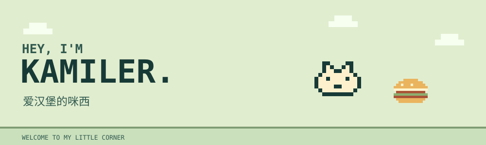

  <a href="#hello">[ HELLO ]</a>
  &nbsp; · &nbsp;
  <a href="https://github.com/KamiLer?tab=repositories">[ REPOSITORIES ]</a>
  &nbsp; · &nbsp;
  <a href="https://github.com/KamiLer?tab=stars">[ STARS ]</a>

## 欢迎来到我的小角落。

**玩家名：KamiLer** / 爱汉堡的咪西

> I like the world！Of course，that's false！喵

<table width="100%">
  <tr>
    <th width="450" align="left">01 / 公开仓库</th>
    <th width="450" align="left">02 / 灵感收藏</th>
  </tr>
  <tr>
    <td>
      从这里逛逛我的公开仓库。  
      <a href="https://github.com/KamiLer?tab=repositories">进入仓库 →</a>
    </td>
    <td>
      看看我在 GitHub 收藏了什么。  
      <a href="https://github.com/KamiLer?tab=stars">看看收藏 →</a>
    </td>
  </tr>
</table>

  <code>THANKS FOR STOPPING BY :)</code>

